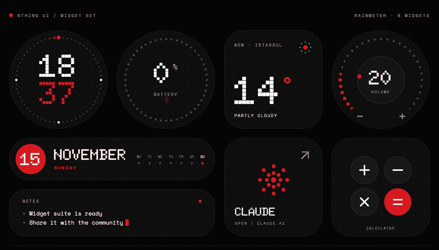
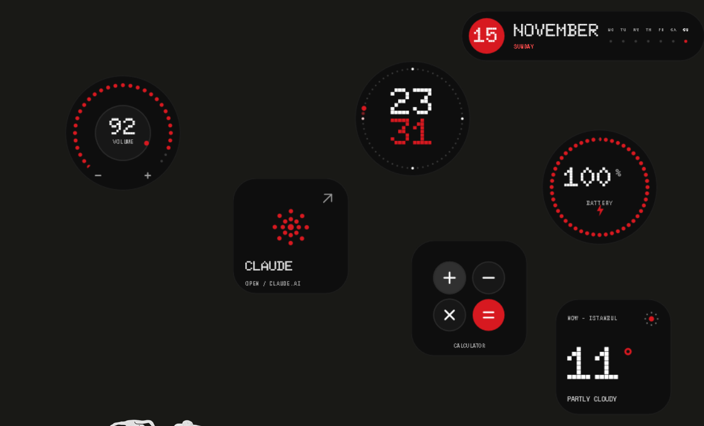
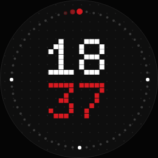
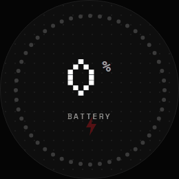
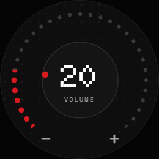
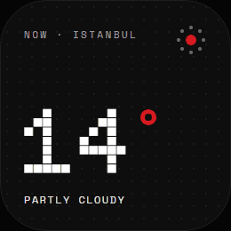
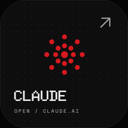
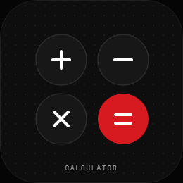

# NThing Widgets

**A Nothing OS-inspired widget suite for Rainmeter** — dot-matrix type, a single red accent, flat black tiles, and small, calm animations.

> Fan-made and unofficial. Not affiliated with, endorsed by, or sponsored by Nothing Technology Limited. "Nothing" is a trademark of its owner; it is used here only to describe the visual style that inspired this project.

### Running on a real desktop

## What's inside

| Widget | What it does | Animation |
| --- | --- | --- |
| **Clock** | 24 h clock in dot-matrix digits on a dotted ring | A red seconds dot with a fading trail travels around the ring |
| **Battery** | Real battery level on a dotted ring | Ring fills on load, bolt blinks while charging |
| **Weather** | Temperature + conditions from [wttr.in](https://wttr.in) (no API key) | Slowly rotating sun |
| **Volume** | Real system volume dial (read and set by a small PowerShell script, `@Resources/Volume.ps1`). `+` / `-` change it by 2 %, click the dial to mute | Dots ease to the new level |
| **Date** | Day, month, weekday and a week strip | Today's dot pulses |
| **Notes** | Shows `Notes.txt`; click to edit | Blinking dot |
| **Claude** | One-click launcher for claude.ai | Rotating dot star |
| **Calculator** | Opens the Windows calculator | Keys light up in sequence |

Every widget has a right-click size menu (75 % – 200 %) and keeps your choice.

  
  
  
  

  
  
  

## Install

**Easiest:** download `NThing-Widgets-1.0.0.rmskin` from the [Releases](../../releases) page and double-click it (needs [Rainmeter](https://www.rainmeter.net) 4.5 or newer).

**Manually:** copy the `Skins/NThingSuite` folder into `Documents\Rainmeter\Skins\`, then in Rainmeter choose *Refresh all* and load the widgets you want from `NThingSuite`.

The package ships its own copies of the **Doto** and **Space Mono** fonts inside `@Resources\Fonts`. Rainmeter loads them automatically, you don't need to install anything.

## Customise

* **Weather city:** edit `Location` in `Skins/NThingSuite/@Resources/Variables.inc`.
* **Accent colour:** edit `Accent` (and `AccentSoft` / `AccentFaint`) in the same file. Try `255,90,31,255` for orange.
* **Notes:** edit `@Resources/Notes.txt` (or click the Notes widget).
* **Size:** right-click any widget → *Size …*.
* **Performance:** animated widgets update 15–25 times a second. Raise the `Update=` value at the top of a widget's `.ini` (for example `Update=100`) to make it lighter.

## Preview / design file

`preview/index.html` is the standalone, animated design board used to render the images in this repository. Open it in any modern browser. Add `?accent=FF5A1F` to try another accent colour, or `?t=1.5` to freeze every animation at 1.5 s.

## Design rules

* Palette: `#000000`, `#B1B3B3`, `#FFFFFF`, and one red `#D71920`.
* No gradients, no shadows.
* Doto for numbers, Space Mono for labels.
* Everything is built from circles and rounded rectangles so it scales cleanly.

## Credits and licences

* Code and skins: MIT, see [LICENSE](LICENSE).
* Fonts: [Doto](https://fonts.google.com/specimen/Doto) and [Space Mono](https://fonts.google.com/specimen/Space+Mono), both under the SIL Open Font License 1.1.
* Weather data: [wttr.in](https://wttr.in).

## Roadmap

Light-tile variants, an analog clock, a weekly forecast strip, toggle pills and more dot-matrix glyph tiles.
